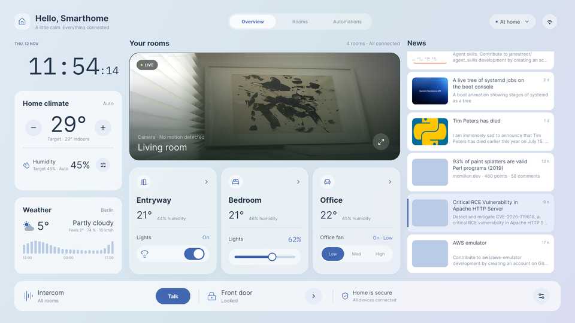
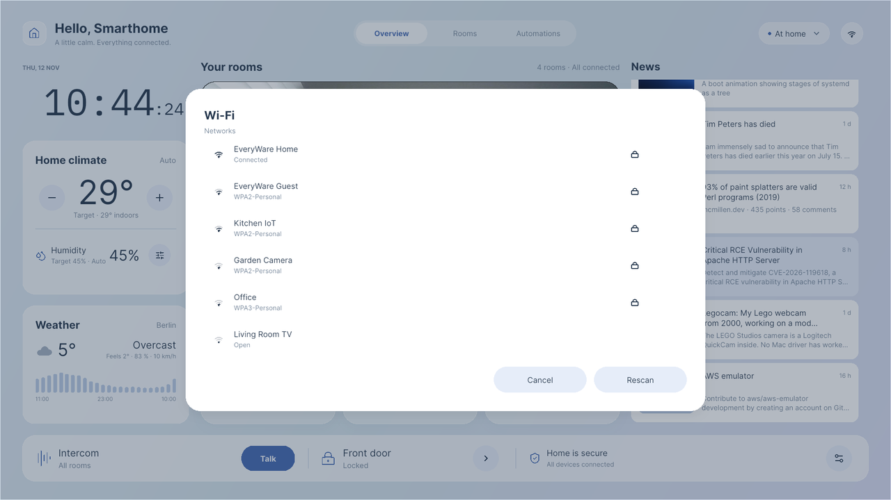
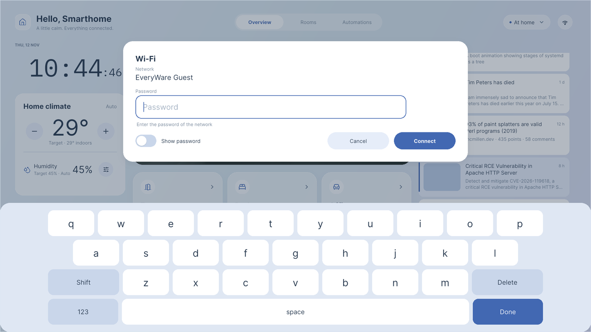
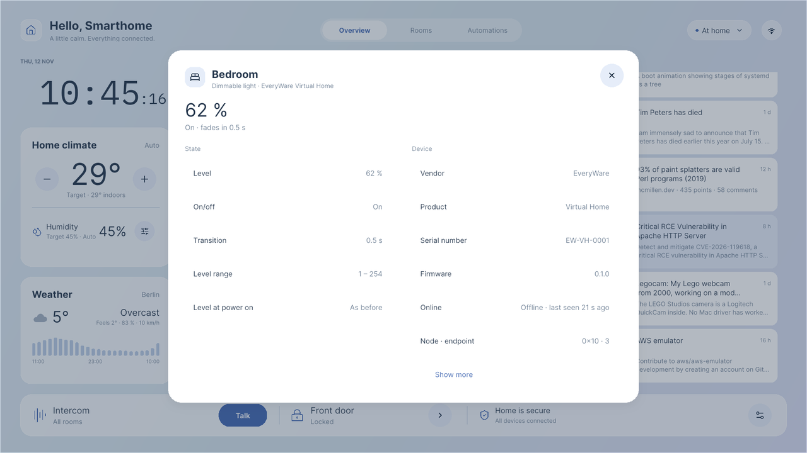
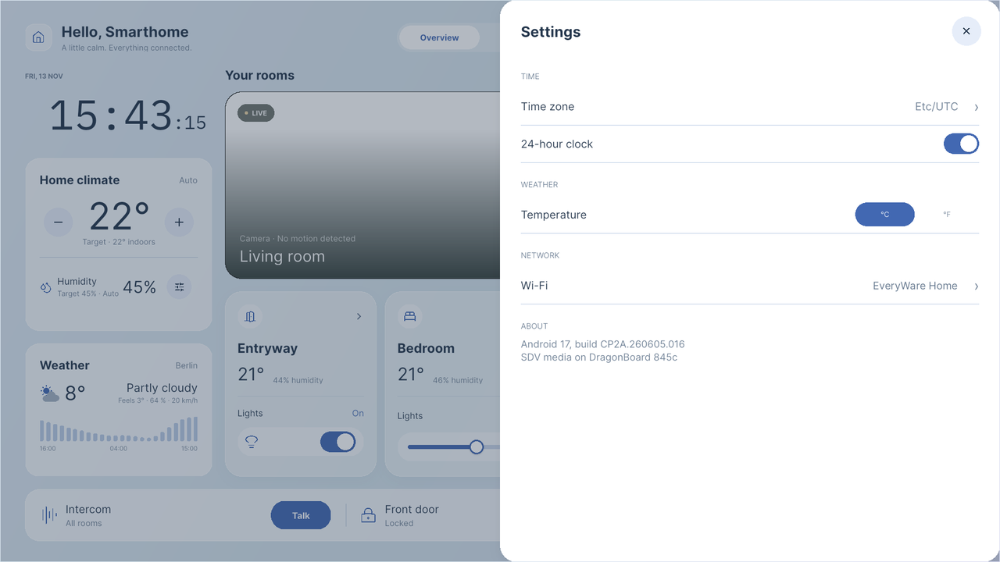
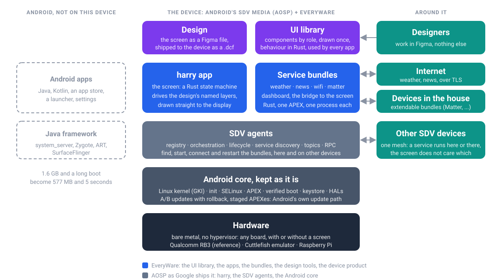
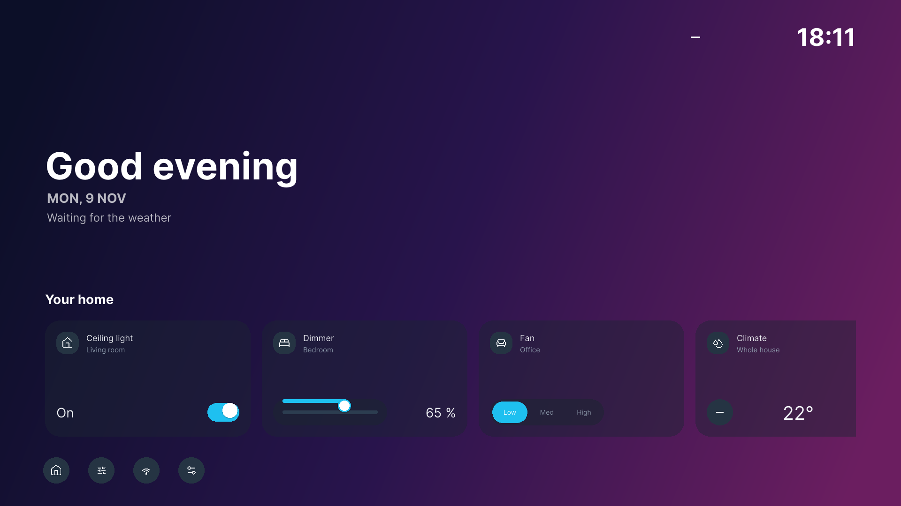
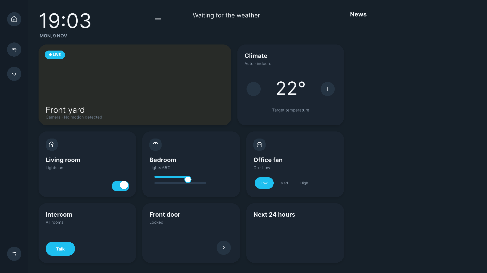
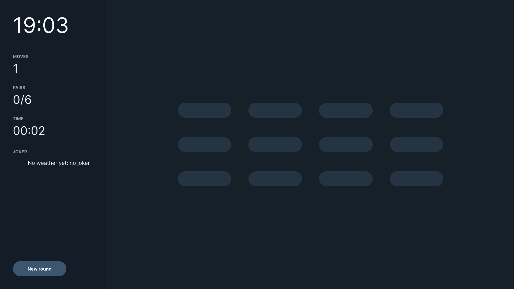

  

<table align="center">
<tr>
<td width="25%"></td>
<td width="25%"></td>
<td width="25%"></td>
<td width="25%"></td>
</tr>
<tr>
<td align="center">Wi-Fi, from the Wi-Fi bundle</td>
<td align="center">The panel's own keyboard</td>
<td align="center">A Matter device, from the Matter bundle</td>
<td align="center">Settings, from the System bundle</td>
</tr>
</table>

<h1 align="center">SDV EveryWare</h1>

  <b>The software of Google's SDV Media on every embedded device, with and without a screen.</b> 
  Not a new OS: the software of Google's <a href="https://source.android.com/docs/automotive/sdv">AAOS SDV</a> taken out of the car.
  No hypervisor, no VirtIO: the Android core runs straight on the hardware. Android without Java. A delightfully fast boot. A Figma design as the screen. Services and UI in Rust.

## Why

Embedded devices with a screen run a full Android that is too big and too slow for them, or a home
grown Linux that nobody updates. Google built a third option for cars: SDV Media, the Android core
without the Java framework, a few native agents, written in Rust, that run and connect services,
and harry, a renderer in Rust that draws a Figma design straight to the display (its safety
monitoring of a cluster's telltales stays off here). Nothing in it is specific to cars.

In a car, SDV Media is a virtual machine on a type 1 hypervisor (QNX, Gunyah) and reaches the
hardware through VirtIO. SDV EveryWare removes all of the virtualization: the SDV software from
AOSP boots straight on the board, with the board's own drivers, and puts it on the wall.

> **Any device that boots Android 17 can run it.** Where a board support package for AOSP exists,
> this system runs on it: headless, or with a screen like the one above.

  

## What you can build

Four apps on one UI library, each a Figma design driven by a small Rust state machine, captured on
the reference board (1920 x 1080, touch):

<table>
<tr>
<td width="33%"></td>
<td width="33%"></td>
<td width="33%"></td>
</tr>
<tr>
<td align="center"><code>tv-app</code>, a smart TV home screen, the reference app</td>
<td align="center"><code>hub-app</code>, the rooms of the house</td>
<td align="center"><code>pairs-app</code>, a memory game with a joker from the weather</td>
</tr>
</table>

The panel at the top of this page is the fourth, `smarthome-app`. A new app is a design patch on
the library and its state, actions and presenter; the service bundles (weather, news, Wi-Fi,
Matter) are shared by all of them.

## Where to start

**The project is built AI first.** Every repository has an `AGENTS.md`, the guide an agent reads
before it touches anything, and the work itself is written down as **skills**: step by step
instructions an agent follows, with the traps.

Your first app, with an agent (Claude Code or any agent that reads `AGENTS.md`): sync the tree
([`everyware`, Get started](https://github.com/sdv-everyware/everyware#get-started)), open it with
the agent and tell it: *"Make a kitchen panel: the time and one light, run it on the board."* The
[`new-app`](https://github.com/sdv-everyware/ui-lib/tree/main/skills/new-app) skill takes it from
that sentence to the screen: the layout agreed as an ASCII sketch, the app's own repository, the
design on the UI library, the `.dcf` without Figma, the state and the presenter, the build, the run
on the board with a screenshot.

| Skill | What the agent does with it |
|---|---|
| [`new-app`](https://github.com/sdv-everyware/ui-lib/tree/main/skills/new-app) | a new app from one sentence, end to end |
| [`use-component`](https://github.com/sdv-everyware/ui-lib/tree/main/skills/use-component) | one more control on a screen: the slot in Figma, the fetch, the binding, the check on the board |
| [`sheet`](https://github.com/sdv-everyware/ui-lib/tree/main/skills/sheet) | a sheet, dialog or side panel over a screen |
| [`ui-component`](https://github.com/sdv-everyware/ui-lib/tree/main/skills/ui-component) | a new component in the library: spec, Figma component set, Rust state machine, harry binding |
| [`service-bundle`](https://github.com/sdv-everyware/everyware/tree/main/skills/service-bundle) | a service bundle: catalog, protos, APEX, policy, deploy, as Android Studio for Platform does it |
| [`figma-design`](https://github.com/sdv-everyware/everyware/tree/main/skills/figma-design) | screens, sheets and overlays in Figma through the kiwi generators, clickable for a designer |
| [`review`](https://github.com/sdv-everyware/everyware/tree/main/skills/review) | the review of a feature branch by a second agent before a person sees it |

Without an agent, the same pages are the tutorials.

| You want to | Go to |
|---|---|
| understand the idea, one concept per page | [`everyware/docs`](https://github.com/sdv-everyware/everyware/tree/main/docs) |
| build the image and flash the reference board | [`everyware`](https://github.com/sdv-everyware/everyware#get-started), then [`device-rb3`](https://github.com/sdv-everyware/device-rb3) |
| read a complete app | [`tv-app`](https://github.com/sdv-everyware/tv-app), the reference app; [`smarthome-app`](https://github.com/sdv-everyware/smarthome-app), the panel |
| add a component to the UI library | [`ui-lib`](https://github.com/sdv-everyware/ui-lib) |
| write a service bundle (weather, Matter, your protocol) | the concept: [3. Service bundles](https://github.com/sdv-everyware/everyware/blob/main/docs/concepts/3-service-bundles.md); the code: [`everyware/bundles`](https://github.com/sdv-everyware/everyware/tree/main/bundles); step by step: [`skills/service-bundle`](https://github.com/sdv-everyware/everyware/tree/main/skills/service-bundle) |
| see what is next and why | [the tracker](https://github.com/sdv-everyware/everyware/issues): every issue starts with the problem and the alternatives |

## The repositories

| | What |
|---|---|
| [`manifest`](https://github.com/sdv-everyware/manifest) | the local manifest that puts everything below into the public AOSP tree (`android-17.0.0_r1`) |
| [`everyware`](https://github.com/sdv-everyware/everyware) | the service bundles, their catalog and policies, the product additions, the design tools, the documentation |
| [`ui-lib`](https://github.com/sdv-everyware/ui-lib) | the UI library: components by role, their behaviour, the Library as a Figma file and as a `.dcf` |
| [`smarthome-app`](https://github.com/sdv-everyware/smarthome-app), [`tv-app`](https://github.com/sdv-everyware/tv-app), [`hub-app`](https://github.com/sdv-everyware/hub-app), [`pairs-app`](https://github.com/sdv-everyware/pairs-app) | the apps on harry |
| [`super-harry`](https://github.com/sdv-everyware/super-harry) | the same harry as AOSP, only faster, touchier and friendlier with Wayland |
| [`device-rb3`](https://github.com/sdv-everyware/device-rb3), [`dragonboard`](https://github.com/sdv-everyware/dragonboard) | the product of the reference board and Linaro's board support |
| [`dnsproxyd`](https://github.com/sdv-everyware/dnsproxyd), [`third_party-rust`](https://github.com/sdv-everyware/third_party-rust), [`third_party-chrony`](https://github.com/sdv-everyware/third_party-chrony) | name resolution without netd, the Rust crates the tree lacks, chrony |
| [`automotive-design-compose`](https://github.com/sdv-everyware/automotive-design-compose) | our fork of DesignCompose: the importer behind the design tools |

Everything is Apache-2.0; the forks keep their upstream notices.
